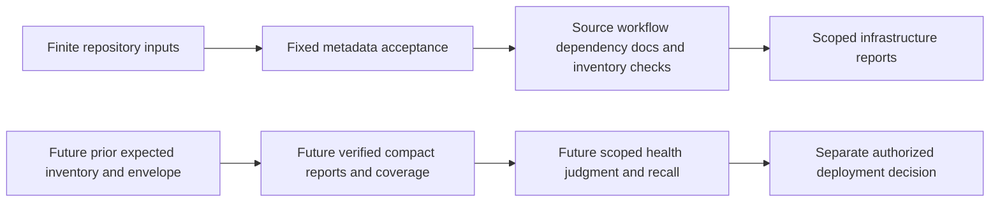

<!--
SPDX-License-Identifier: AGPL-3.0-or-later
Commercial license available
© Concepts 1996–2026 Miroslav Šotek. All rights reserved.
© Code 2020–2026 Miroslav Šotek. All rights reserved.
ORCID: 0009-0009-3560-0851
Contact: www.anulum.li | protoscience@anulum.li
FIELD-OPS-WITNESS — repository governance and provenance
-->

# Architecture

The implemented surface is local repository validation tooling under tools/field_validation. Fixed scripts validate metadata, maintained source and licence provenance, workflow policy, development dependencies, rendered documentation and deterministic inventory. Structured reports cover the named infrastructure operation only.

The independent closed metadata schema binds identity, governance profile, interpreter and raw development lock. Metadata acceptance precedes exclusive complete output creation; read-only inventory verification never repairs input.

The planned field library consumes compact source-qualified unit reports against an earlier expected inventory and deployment envelope. Identity, freshness, quarantine and complete coverage precede a scoped drift verdict. Reporter generation, local report indexing, recall queries and a non-actuating health feed remain future interfaces.

Common representation and trust stay with EVIDENCE-MANIFEST-TOOLKIT; global lineage stays with Ledger. Field Ops judges, Deploy Pack acts through separate authority, Recorder retains its distinct raw-data lane, and Studio renders the same evidence. These are planned integrations, not installed dependencies.

Read the [component guide](docs/ARCHITECTURE.md), [trust boundaries](docs/THREAT_MODEL.md) and [validation commands](VALIDATION.md).
